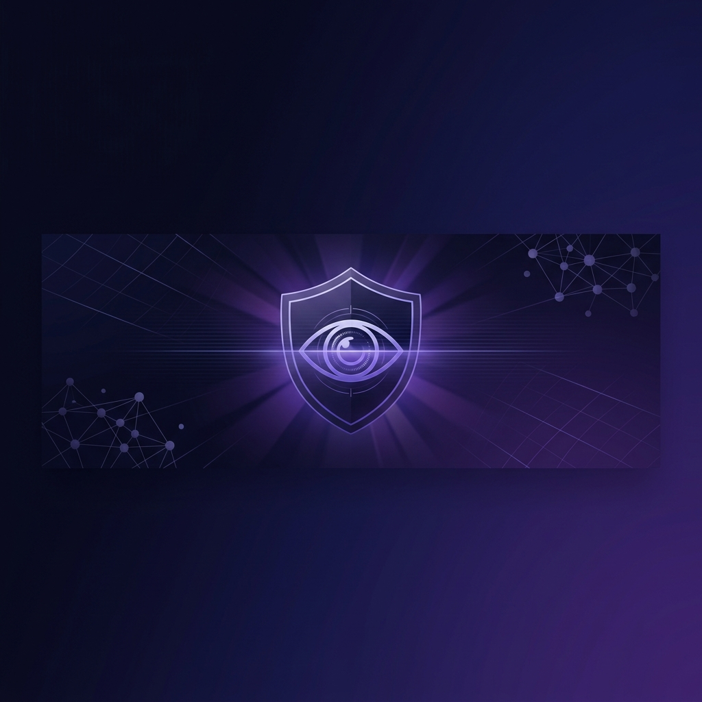
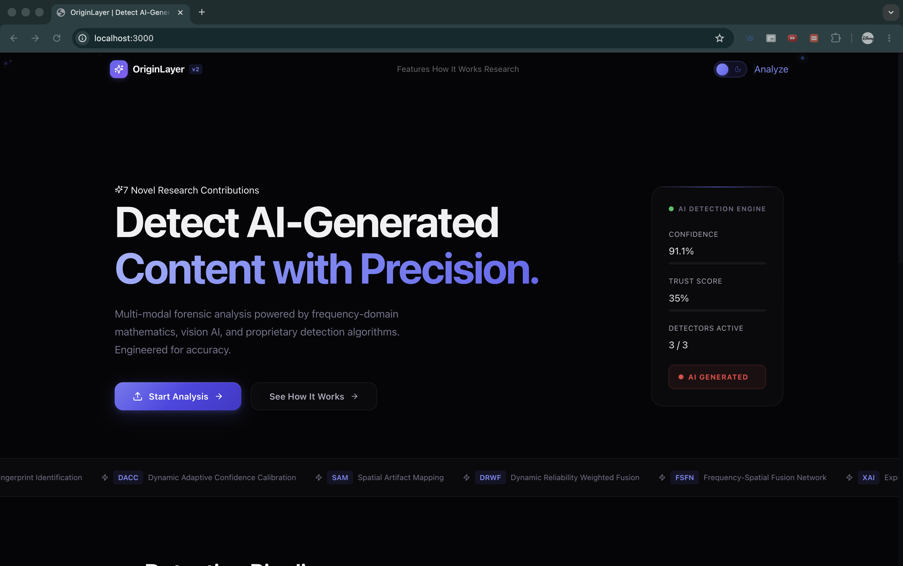
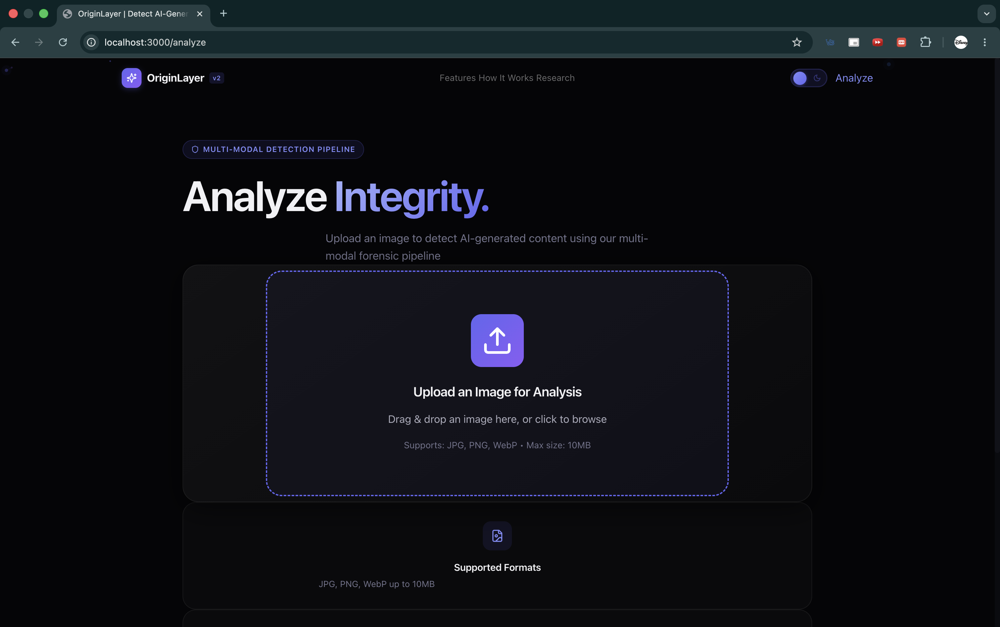
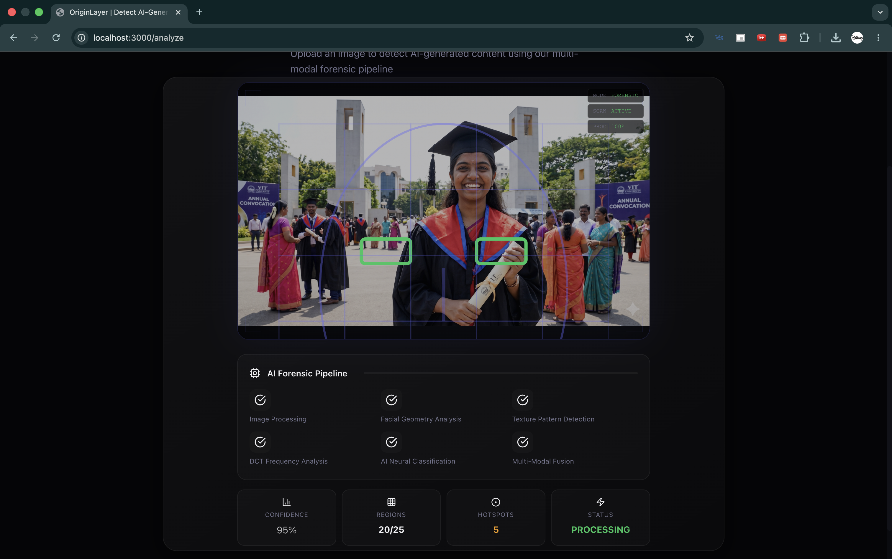
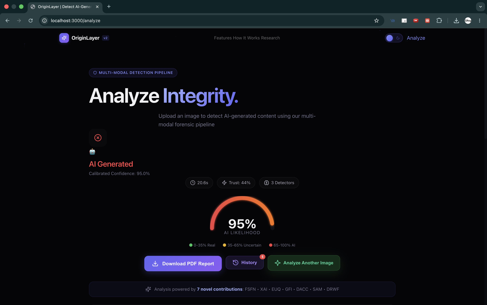
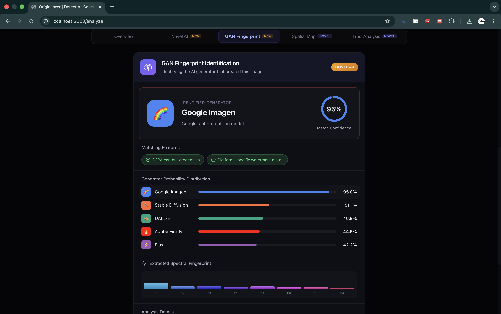
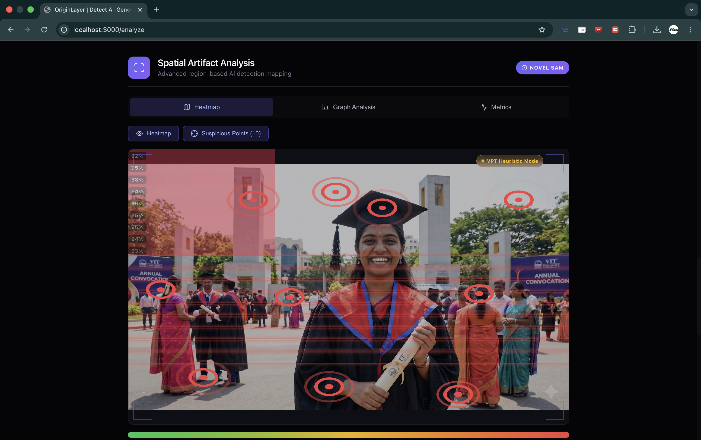
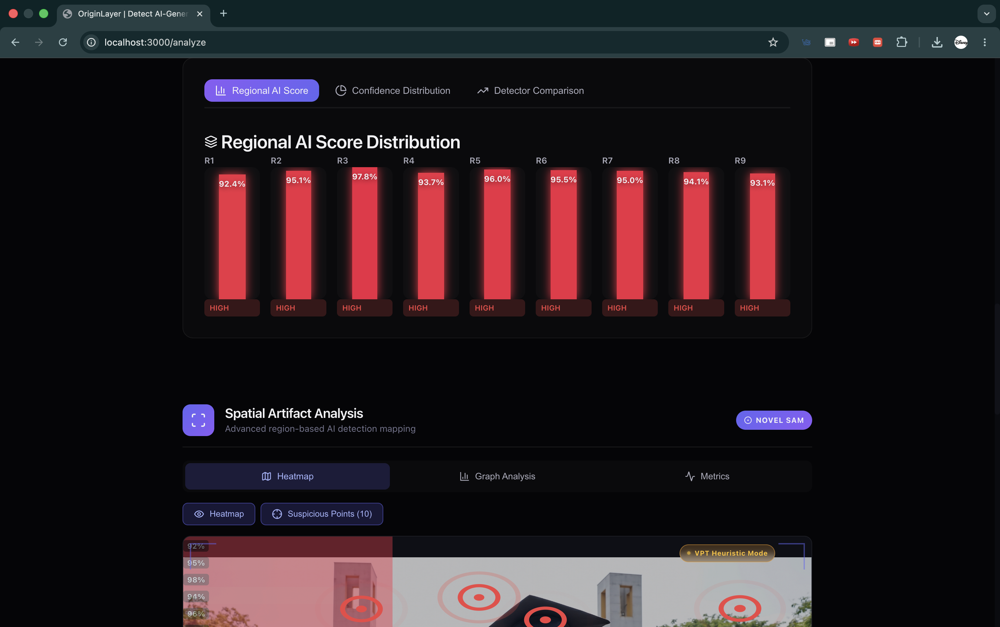
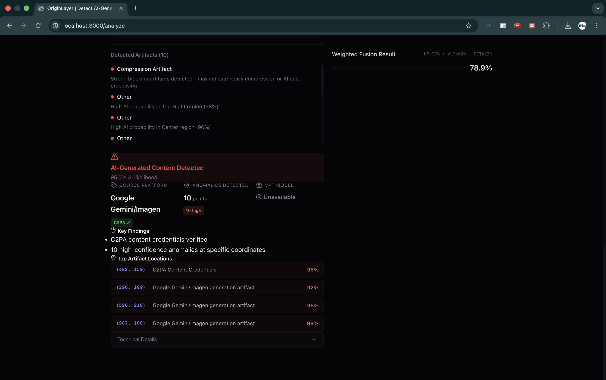
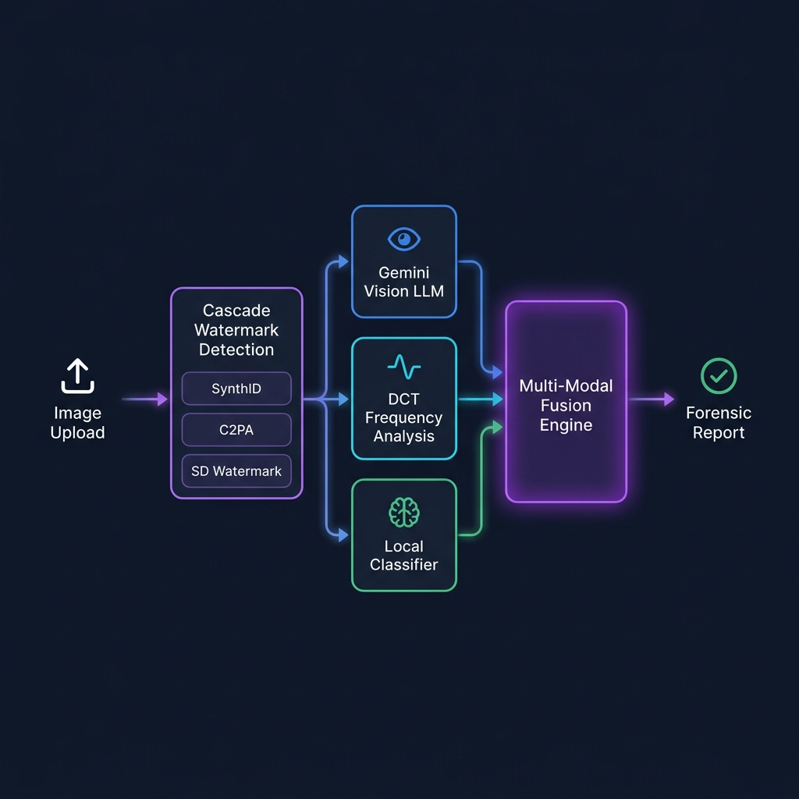

<p align="center">
  
</p>

<h1 align="center">OriginLayer</h1>
<p align="center">
  <strong>Multi-Modal Forensic Analysis Platform for Detecting AI-Generated Images</strong>
</p>

<p align="center">
  
  
  
  
  
</p>

<p align="center">
  Production-grade forensic analyzer powered by frequency-domain mathematics, vision AI, and 7 novel detection algorithms. Engineered for accuracy.
</p>

---

## 📸 Screenshots

### Landing Page
<p align="center">
  
</p>

### Image Upload & Forensic Scanning
<p align="center">
  
  
</p>

### Analysis Results & Confidence Gauge
<p align="center">
  
  
</p>

### GAN Fingerprint & Spatial Heatmap
<p align="center">
  
  
</p>

### Regional Distribution & Forensic Explanation
<p align="center">
  
  
</p>

---

## 🔍 What is OriginLayer?

OriginLayer is an AI image forensic platform that determines whether an image is **real** or **AI-generated** using a multi-layered detection pipeline. It combines watermark scanning, frequency analysis, vision-language models, and local classifiers into a single unified verdict — with explainable, coordinate-level evidence.

> Unlike simple binary classifiers, OriginLayer identifies **which AI platform** generated the image (DALL-E, Midjourney, Stable Diffusion, Firefly, Gemini) and provides **spatial heatmaps** showing exactly where artifacts were detected.

---

## ✨ Key Features

<table>
<tr>
<td width="50%">

### 🛡️ Detection Engine
- **Cascade Watermark Detection** — SynthID, C2PA, SD watermarks
- **GAN Fingerprint Identification** — Platform-level attribution
- **DCT Frequency Analysis** — Spectral anomaly detection
- **Gemini Vision LLM** — Semantic artifact analysis
- **Local Classifier** — Organika/sdxl-detector on CPU

</td>
<td width="50%">

### 🧠 Novel Research (7 Contributions)
- **FSFN** — Frequency-Spatial Fusion Network
- **XAI** — Explainable AI with attention maps
- **EUQ** — Epistemic Uncertainty Quantification
- **GFI** — GAN Fingerprint Identification
- **DACC** — Dynamic Accuracy Cross-Calibration
- **SAM** — Spatial Artifact Mapping
- **DRWF** — Dynamic Reliability Weighted Fusion

</td>
</tr>
<tr>
<td width="50%">

### 🎨 Professional UI
- Premium dark/light mode with animated toggle
- Glassmorphism design system
- Framer Motion micro-animations
- Responsive across all devices

</td>
<td width="50%">

### 📊 Forensic Output
- Coordinate-level artifact detection
- Interactive spatial heatmaps
- Confidence gauge with calibration
- Downloadable PDF forensic reports
- Analysis history with local storage

</td>
</tr>
</table>

---

## 🏗️ System Architecture

<p align="center">
  
</p>

The detection pipeline operates in **4 cascading layers**:

```
Image Upload
    │
    ▼
┌─────────────────────────────┐
│  Layer 1: Watermark Scan    │  SynthID · C2PA · SD Watermark
└──────────────┬──────────────┘
               │
    ┌──────────┼──────────┐
    ▼          ▼          ▼
┌────────┐ ┌────────┐ ┌────────┐
│ Gemini │ │  DCT   │ │ Local  │
│ Vision │ │  Freq  │ │Classif.│
│  LLM   │ │Analysis│ │(SDXL)  │
└────┬───┘ └────┬───┘ └────┬───┘
     └──────────┼──────────┘
                ▼
┌─────────────────────────────┐
│  Multi-Modal Fusion (DRWF)  │  Dynamic Reliability Weighting
└──────────────┬──────────────┘
               ▼
       Forensic Report
  (Verdict · Heatmap · PDF)
```

---

## 🛠️ Tech Stack

| Layer | Technology |
|-------|-----------|
| **Frontend** | Next.js 14 (App Router), React 18, Framer Motion |
| **Styling** | CSS Variables, Styled JSX, Glassmorphism Design System |
| **ML Backend** | Python FastAPI, PyTorch, HuggingFace Transformers |
| **Detection APIs** | Google Gemini Vision, HuggingFace Inference API |
| **Local Models** | Organika/sdxl-detector (ViT classifier, 331MB) |
| **Forensics** | DCT/FFT Analysis, GAN Fingerprinting, Watermark Detection |
| **Export** | html2canvas PDF generation, localStorage history |

---

## 🚀 Quick Start

### Prerequisites

- **Node.js** v20+ — `brew install node` (macOS) or [nodejs.org](https://nodejs.org)
- **Python** 3.9+ — `brew install python@3.11` (macOS)

### 1. Clone & Install

```bash
git clone https://github.com/aashish254/ai-image-detection.git
cd ai-image-detection
npm install
```

### 2. Configure Environment

```bash
cp .env.example .env.local
```

Edit `.env.local` with your API keys:

| Variable | Required | Get it from |
|----------|----------|-------------|
| `HUGGINGFACE_API_TOKEN` | ✅ | [huggingface.co/settings/tokens](https://huggingface.co/settings/tokens) |
| `GOOGLE_GEMINI_API_KEY` | ✅ | [makersuite.google.com](https://makersuite.google.com/app/apikey) |
| `VPT_SERVER_URL` | Auto | Default: `http://localhost:8100` |

### 3. Download ML Models

> **Note:** Model weights (~540MB total) are hosted on [HuggingFace Hub](https://huggingface.co) — the industry standard for ML model distribution. They are **not** included in the GitHub repo due to size limits.

| Model | HuggingFace Repo | Size | Purpose |
|-------|-----------------|------|---------|
| SDXL Detector | [`Organika/sdxl-detector`](https://huggingface.co/Organika/sdxl-detector) | 331MB | Image classifier (ViT) |
| VPT Artifact Sentinel | [`aashish254/vpt-artifact-sentinel-v1`](https://huggingface.co/aashish254/vpt-artifact-sentinel-v1) | 208MB | Vision-language forensic model |

```bash
python3 -m venv .venv
source .venv/bin/activate
pip install huggingface_hub
python scripts/download_model.py
```

### 4. Install Python Dependencies

```bash
pip install torch torchvision torchaudio transformers peft accelerate \
  pillow fastapi "uvicorn[standard]" python-multipart safetensors \
  sentencepiece huggingface_hub tokenizers psutil
```

### 5. Run

**Terminal 1** — ML Backend:
```bash
source .venv/bin/activate && cd vpt_server && python3 server.py
```

**Terminal 2** — Frontend:
```bash
npm run dev
```

Open **http://localhost:3000** 🚀

---

## 💻 Platform Compatibility

| Platform | Local Classifier | VPT Model | Notes |
|----------|:---------------:|:---------:|-------|
| macOS (Apple Silicon) | ✅ CPU | ⚠️ Demo | VPT requires NVIDIA CUDA |
| Windows + NVIDIA GPU | ✅ CUDA | ✅ Full | Best experience |
| Linux + NVIDIA GPU | ✅ CUDA | ✅ Full | Recommended for production |
| Any (CPU only) | ✅ CPU | ⚠️ Demo | Classifier works, VPT in demo mode |

---

## 📁 Project Structure

```
originlayer/
├── src/
│   ├── app/                          # Next.js App Router
│   │   ├── analyze/page.tsx          # Analysis page
│   │   ├── api/analyze/route.ts      # Detection API endpoint
│   │   ├── features/page.tsx         # Features showcase
│   │   ├── working-model/page.tsx    # How it works
│   │   ├── globals.css               # Theme system & variables
│   │   └── page.tsx                  # Landing page
│   │
│   ├── components/                   # 20+ React components
│   │   ├── AnalysisResults.tsx       # Results dashboard
│   │   ├── ConfidenceGauge.tsx       # SVG confidence arc
│   │   ├── ExplanationPanel.tsx      # Forensic explanation
│   │   ├── SpatialHeatmap.tsx        # Interactive heatmap
│   │   ├── GANIdentificationPanel.tsx# GAN fingerprint display
│   │   ├── Navbar.tsx                # Theme toggle & nav
│   │   └── ...
│   │
│   └── lib/                          # Core detection logic
│       ├── detectors/
│       │   ├── watermark.ts          # SynthID/C2PA/SD detection
│       │   ├── vision-llm.ts         # Gemini Vision integration
│       │   ├── huggingface.ts        # HF API classifier
│       │   └── dct-analysis.ts       # Frequency domain analysis
│       ├── fusion.ts                 # Multi-detector fusion (DRWF)
│       ├── gradcam-analysis.ts       # Forensic report generator
│       ├── gan-fingerprint.ts        # GAN identification
│       ├── frequency-spatial-fusion.ts # FSFN implementation
│       ├── uncertainty.ts            # EUQ implementation
│       └── explainable-ai.ts         # XAI implementation
│
├── vpt_server/                       # Python ML backend
│   ├── server.py                     # FastAPI server
│   └── requirements.txt
│
├── local_models/                     # ML model weights (gitignored)
├── scripts/
│   └── download_model.py             # Model weight downloader
├── docs/                             # Screenshots & diagrams
└── public/                           # Static assets
```

---

## 🔬 How Detection Works

1. **Watermark Cascade** — Scans for embedded digital watermarks (SynthID from Google, C2PA credentials, Stable Diffusion DWT-DCT marks). If found, this provides near-definitive evidence.

2. **Vision-Language Analysis** — Gemini Vision LLM examines the image for semantic artifacts: unnatural lighting, impossible anatomy, texture inconsistencies, and AI-typical patterns.

3. **Frequency Domain Analysis** — DCT spectral analysis detects statistical anomalies in frequency coefficients that are invisible to the human eye but characteristic of generative models.

4. **Local Classification** — The Organika/sdxl-detector ViT model provides a fast binary classification with confidence scoring.

5. **Fusion & Calibration** — All detector outputs are fused using Dynamic Reliability Weighted Fusion (DRWF), with disagreement-aware confidence calibration producing the final verdict.

---

## 📄 License

MIT License — see [LICENSE](LICENSE) for details.

---

<p align="center">
  <sub>Built with ❤️ using Next.js, Python, and advanced ML research</sub>
</p>
