<p align="center">
  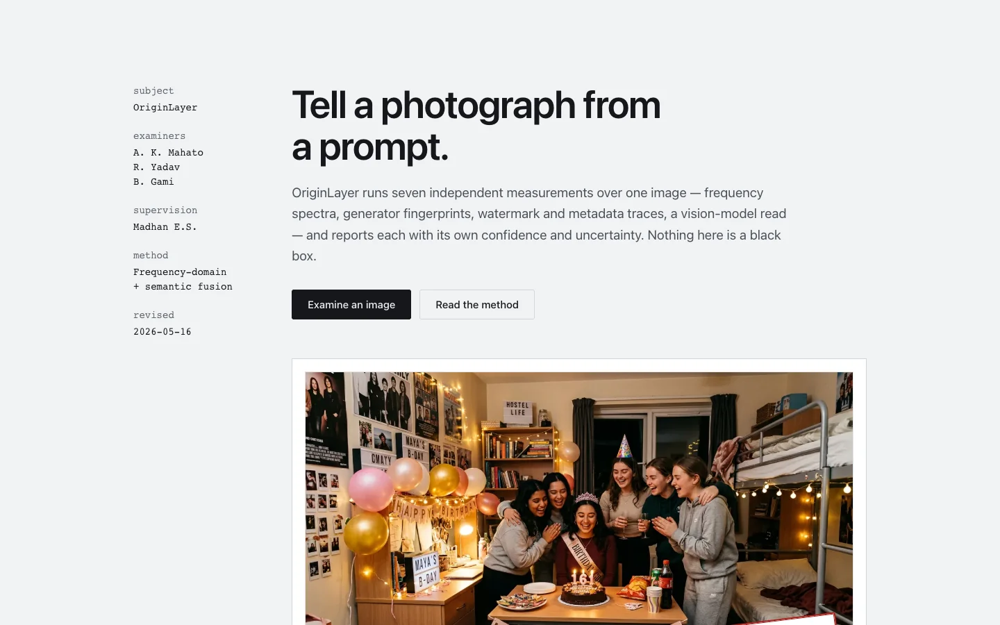
</p>

# OriginLayer

**Multi-modal forensic analysis for AI-generated images.**

OriginLayer runs seven independent measurements over one image and issues one report. Three of
those measurements are weighted into a verdict — a local classifier, a vision-language read and an
in-browser frequency analysis — and the report shows each read's own confidence, status and
latency next to the others. When the reads disagree, the verdict says so instead of hiding it.

Version 2.0.0 · MIT · Next.js 14 App Router + a Python FastAPI model server.

---

## What you get

<p align="center">
  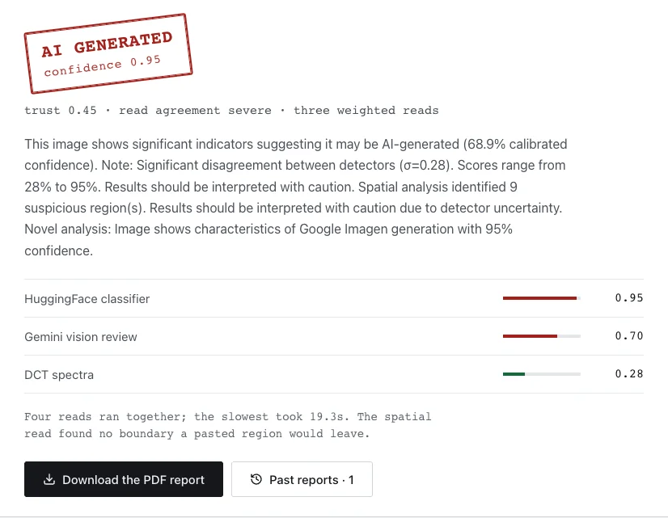
</p>

- **A verdict with a band, not a boolean.** Five states — `AI_GENERATED`, `LIKELY_AI`, `UNCERTAIN`,
  `LIKELY_REAL`, `REAL` — derived from a calibrated score, plus a trust line that names the spread
  between the reads.
- **Seven measurements per image.** Each one is scored and timed on its own row.
- **Attribution, when there is evidence for it.** Six generator profiles (DALL-E, Midjourney,
  Stable Diffusion, Adobe Firefly, Google Imagen, Flux) and a watermark cascade for SynthID, C2PA
  and Stable Diffusion marks.
- **A spatial map.** Artifact regions are flagged with coordinates and severity rather than a
  single whole-frame number.
- **Reliability accounting.** Disagreement-aware calibration, epistemic uncertainty and a plain
  recommendation: safe to report, report with the spread shown, or a person should look at it.
- **A PDF of the report** and a local history of past examinations in your browser.
- **Light and dark.** Same document layout in both; the theme is stored locally.

<p align="center">
  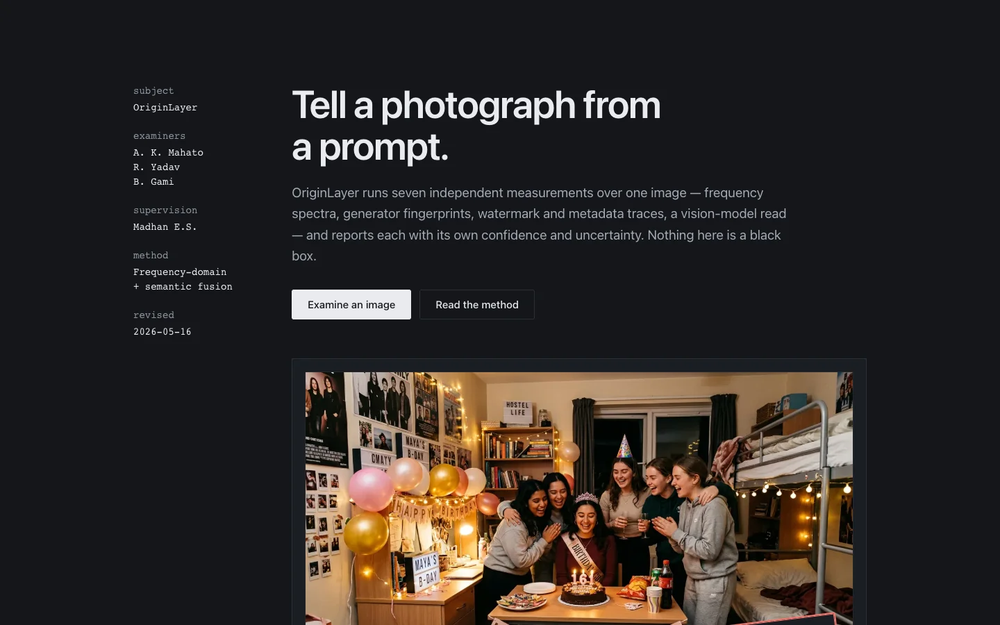
</p>

---

## The seven measurements

Three are weighted into the verdict. Four run alongside them and appear in the report's own
sections. Base weights are in
[`src/lib/dynamic-weights.ts`](src/lib/dynamic-weights.ts) and are re-scaled per run by each read's
confidence, status and latency.

| Measurement | What it does | Where it runs | Base weight |
|---|---|---|---|
| Local classifier | `Organika/sdxl-detector`, a ViT image classifier | Python server, `POST /classify-json` | 30% |
| Gemini vision review | Semantic read of the whole frame — anatomy, lighting, texture, text | Google Gemini, `gemini-3-flash-preview` | 55% |
| DCT spectra | 8×8 block frequency statistics | Browser, `src/lib/detectors/dct-analysis.ts` | 15% |
| Watermark & metadata cascade | SynthID, C2PA and Stable Diffusion mark scanning | Server, before fusion | supporting |
| FSFN | Fuses the frequency and spatial signals, reports domain agreement | `src/lib/frequency-spatial-fusion.ts` | supporting |
| GAN generator fingerprint | Correlates the signal against six generator profiles | `src/lib/gan-fingerprint.ts` | supporting |
| VPT artifact sentinel | Bounding boxes around suspected artifact regions | Python server (needs a CUDA GPU) | supporting |

### Verdict thresholds

The calibrated score maps to a verdict at
[`src/app/api/analyze/route.ts:375`](src/app/api/analyze/route.ts#L375):

| Calibrated score | Verdict |
|---|---|
| ≥ 0.80 | `AI_GENERATED` |
| ≥ 0.60 | `LIKELY_AI` |
| ≥ 0.40 | `UNCERTAIN` |
| ≥ 0.25 | `LIKELY_REAL` |
| < 0.25 | `REAL` |

---

## Screenshots

### Examination request

<p align="center">
  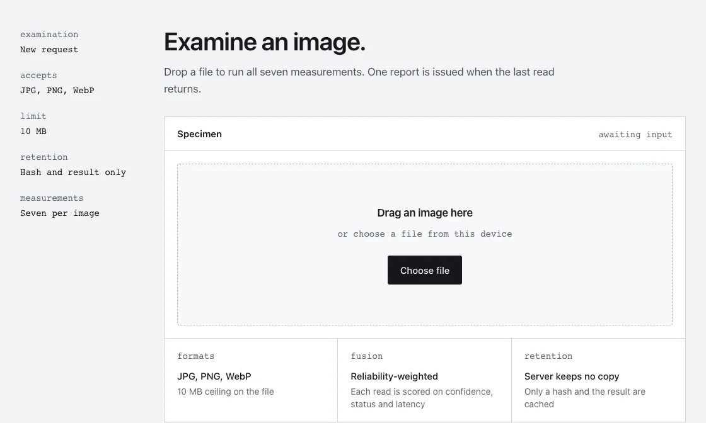
</p>

### Overview — where each score came from

<p align="center">
  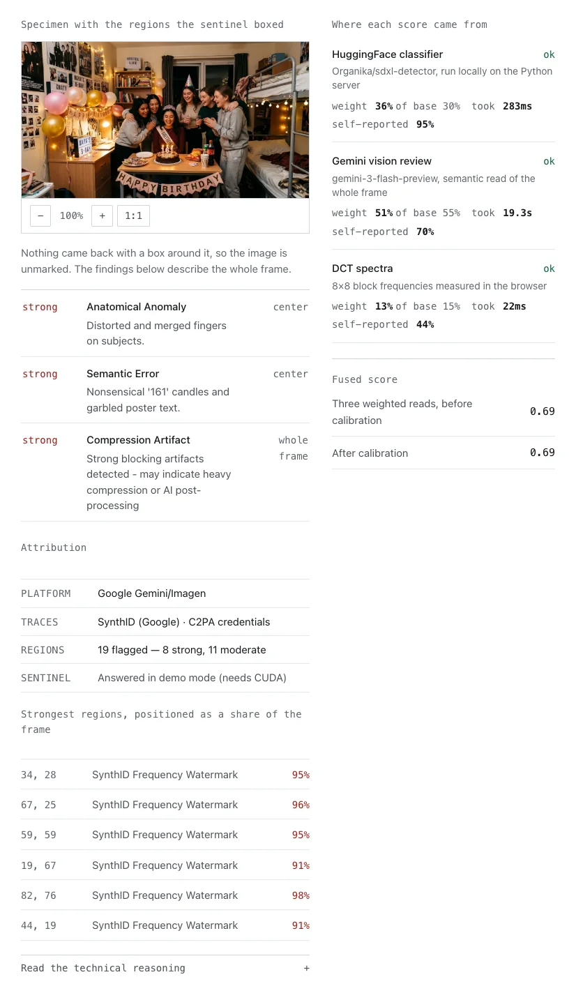
</p>

### Novel methods

<p align="center">
  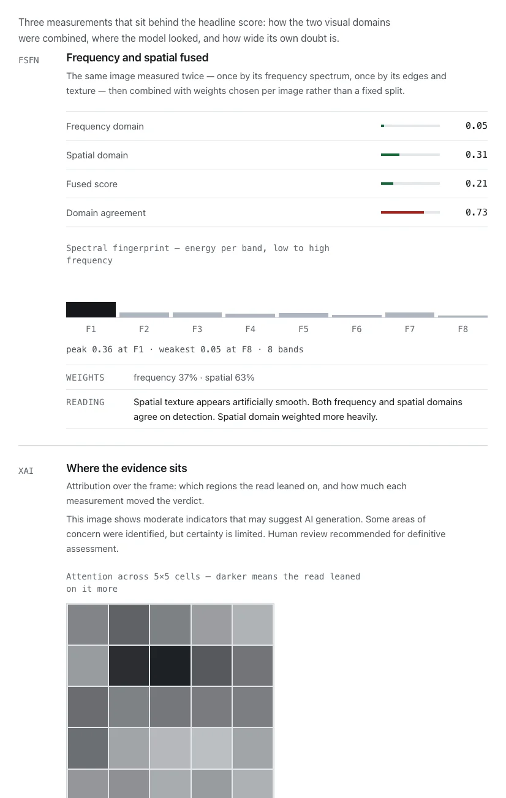
</p>

### Generator attribution

<p align="center">
  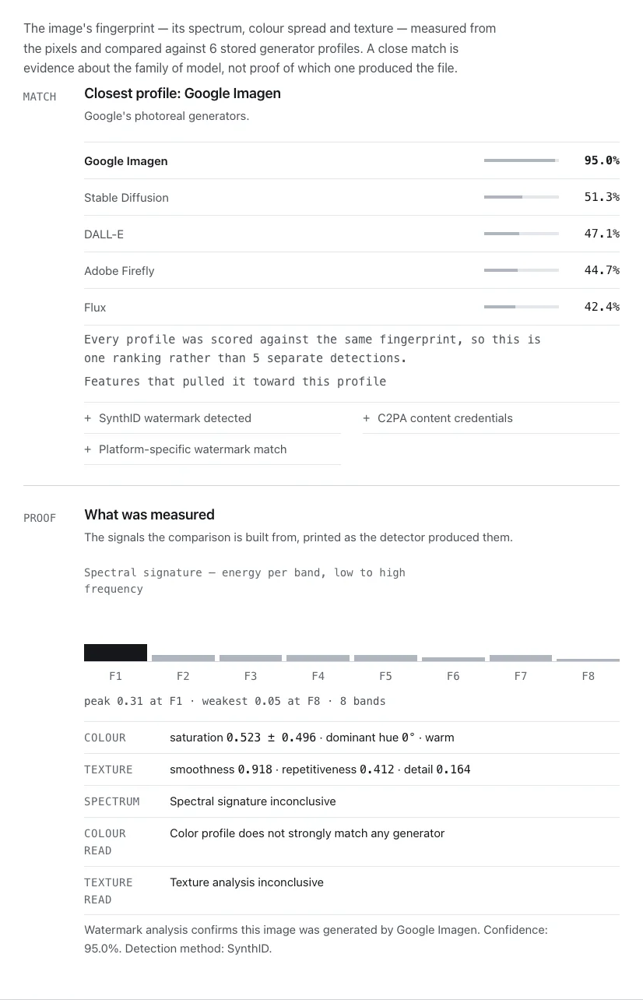
</p>

### Spatial map

<p align="center">
  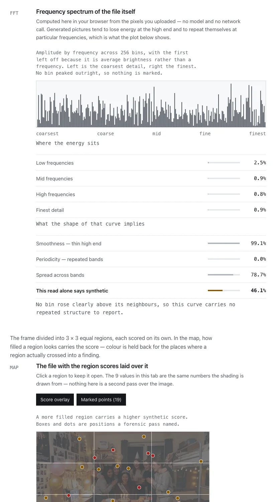
</p>

### Reliability

<p align="center">
  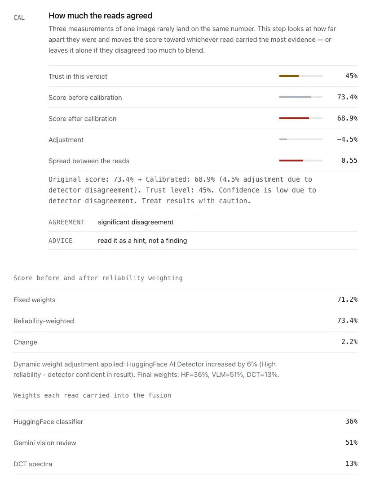
</p>

### Past reports

<p align="center">
  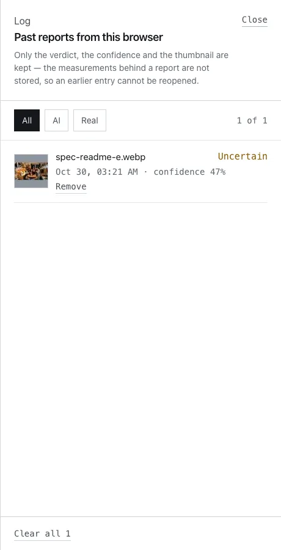
</p>

### Landing page specimen

<p align="center">
  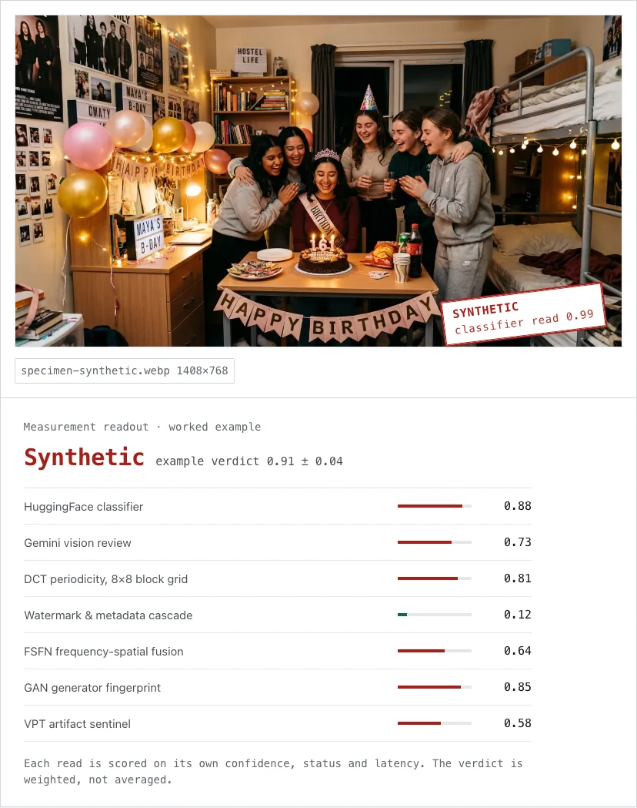
</p>

---

## Architecture

<p align="center">
  
</p>

```
Browser: file → data URL → POST /api/analyze
                              │
                    image hash · cache lookup (24 h, in-process)
                              │
              ┌───────────────┼───────────────┐
              ▼               ▼               ▼
      Local classifier   Gemini vision    DCT spectra
      (FastAPI :8100)    (55% weight)     (in browser)
              └───────────────┼───────────────┘
                              ▼
        Watermark cascade · FSFN · GAN fingerprint · VPT sentinel
                              ▼
              DRWF fusion → disagreement-aware calibration
                              ▼
              Verdict · confidence · per-read provenance
```

The client sends the image once. The server keeps no copy of the pixels — only the hash and the
result are cached, for 24 hours, in an in-process map of up to 100 entries
([`src/lib/cache.ts`](src/lib/cache.ts)); an optional Redis layer sits behind the same interface.
Analysis history lives in `localStorage` under `ai_forensic_history`.

---

## Novel contributions

Named as they appear in [`src/app/novelty/page.tsx`](src/app/novelty/page.tsx):

| | Contribution | What it adds |
|---|---|---|
| DRWF | Dynamic reliability-weighted fusion | Re-weights the three reads per run instead of fixing their contributions |
| FSFN | Frequency-spatial fusion network | Combines spectral and spatial signals and reports whether the two domains agree |
| SAM | Spatial artifact mapping | Turns whole-frame scores into positioned, severity-ranked regions |
| GFI | GAN fingerprint identification | Attributes synthetic output to one of six generator profiles |
| DACC | Dynamic adaptive confidence calibration | Pulls the score toward the spread between reads when they disagree |
| EUQ | Epistemic uncertainty quantification | Separates what the system does not know from measurement noise |
| XAI | Explainable forensic reports | Emits the findings, coordinates and reasoning behind the verdict |

---

## Tech stack

| Layer | Technology |
|---|---|
| Frontend | Next.js 14.2.3 (App Router), React 18, TypeScript |
| Styling | CSS custom properties + styled-jsx, no utility framework |
| Motion & icons | Framer Motion, lucide-react |
| Upload & notices | react-dropzone, react-hot-toast |
| PDF export | jsPDF — the report is laid out as text, not screenshotted |
| Model server | Python FastAPI + Uvicorn, PyTorch, Transformers, PEFT |
| Local models | `Organika/sdxl-detector` (ViT classifier), VPT Artifact Sentinel (Qwen2.5-VL-7B + LoRA) |
| Vision API | Google Gemini `gemini-3-flash-preview`, with fallbacks |

---

## Quick start

### Prerequisites

- **Node.js 18.17 or newer** — this was developed on 24.x
- **Python 3.9 or newer** — for the local classifier and the sentinel server

### 1. Install and configure

```bash
git clone https://github.com/aashish254/ai-image-detection.git
cd ai-image-detection
npm install
cp .env.example .env.local
```

Edit `.env.local`:

| Variable | Required | Notes |
|---|---|---|
| `GOOGLE_GEMINI_API_KEY` | yes | [aistudio.google.com/apikey](https://aistudio.google.com/apikey). Without it the 55%-weighted read fails and the verdict is fused from the other two. |
| `VPT_SERVER_URL` | no | Defaults to `http://localhost:8100` |
| `REDIS_URL` | no | Shares the 24-hour result cache across processes; without it the cache is in-memory only |

### 2. Python environment and model weights

```bash
python3 -m venv .venv
source .venv/bin/activate

# Classifier only (any machine, including macOS):
pip install torch torchvision transformers pillow fastapi "uvicorn[standard]" python-multipart peft accelerate

# Full VPT sentinel (Linux with CUDA):
pip install -r vpt_server/requirements.txt
pip install "unsloth[colab-new]" bitsandbytes

pip install huggingface_hub
python scripts/download_model.py
```

`scripts/download_model.py` pulls [`Organika/sdxl-detector`](https://huggingface.co/Organika/sdxl-detector)
(331 MB, the classifier) and
[`aashish254/vpt-artifact-sentinel-v1`](https://huggingface.co/aashish254/vpt-artifact-sentinel-v1)
(208 MB, the sentinel) into `local_models/`. Only the classifier is needed to run the app.

### 3. Run

**Terminal 1** — model server:

```bash
source .venv/bin/activate && cd vpt_server && python3 server.py
```

**Terminal 2** — app:

```bash
npm run dev
```

Open **http://localhost:3000**. Check the server first if a run looks thin:
`curl localhost:8100/health` reports which models are loaded and on what device.

---

## Platform compatibility

| Platform | Local classifier | VPT sentinel |
|---|---|---|
| Linux or Windows with an NVIDIA GPU | CUDA | Full — returns artifact boxes |
| macOS, Apple Silicon | CPU | Demo mode — the model needs CUDA |
| Any CPU-only machine | CPU | Demo mode |

Demo mode is not an error: the report prints *"Answered in demo mode (needs CUDA)"* on the
sentinel line and no boxes are drawn, so the spatial map falls back to whole-frame findings.

---

## Project layout

```
src/
├── app/
│   ├── page.tsx                 Landing page
│   ├── analyze/page.tsx         Examination request and report
│   ├── features/page.tsx        Feature index
│   ├── novelty/page.tsx         The seven contributions
│   ├── working-model/page.tsx   Method write-up
│   ├── api/analyze/route.ts     Orchestration, fusion, calibration
│   └── globals.css              Token layer and report primitives
├── components/                  23 files; AnalysisResults, DetectorBreakdown,
│                                ExplanationPanel, SpatialHeatmap, ArtifactViewer,
│                                GANIdentificationPanel, NovelContributionsPanel,
│                                TrustIndicator, MeasureRow, SpectralStrip, …
└── lib/
    ├── detectors/               huggingface · vision-llm · dct-analysis · watermark
    ├── fusion.ts                DRWF fusion
    ├── dynamic-weights.ts       Base weights and per-run reliability
    ├── calibration.ts           Disagreement-aware calibration (DACC)
    ├── frequency-spatial-fusion.ts  FSFN
    ├── gan-fingerprint.ts       Six generator profiles (GFI)
    ├── uncertainty.ts           EUQ
    ├── explainable-ai.ts        XAI findings and attention map
    ├── gradcam-analysis.ts      Forensic report assembly
    ├── spatial-analysis.ts      Region mapping (SAM)
    ├── vpt-integration.ts       Model-server client
    ├── cache.ts                 Hash → result cache
    ├── report.ts                Shared verdict/tone semantics for the UI
    └── types.ts                 Detector and report contracts

vpt_server/server.py             FastAPI: /health /classify-json /analyze-json
scripts/download_model.py        Model weight downloader
docs/                            README images and the architecture diagram
public/specimen-synthetic.webp   The AI-generated specimen shown on the landing page
```

---

## What this project does not claim

- **No published accuracy figure.** There is no held-out labelled benchmark behind these numbers,
  so the report shows the reads and their disagreement rather than a headline percentage. If you
  want an accuracy claim, measure one against a set you trust.
- **Not a watermark reader with guaranteed coverage.** The cascade reports what it finds; "no trace"
  means no trace, not that none was ever present.
- **The sentinel is GPU-only.** Without CUDA, artifact boxes are unavailable and the spatial map
  falls back to frequency findings.
- **The cache is per-process.** Restarting `npm run dev` clears it; it is not shared between
  instances.

---

## Authors

Rahul Yadav · Aashish Kumar Mahato · Bibek Gami

## License

MIT — see [LICENSE](LICENSE).

<p align="center">
  <sub>Built with Next.js, Python and frequency-domain mathematics.</sub>
</p>
